<p align="center">
  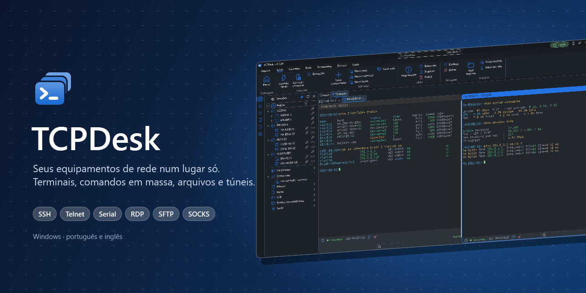
</p>

<p align="center">
  <a href="https://github.com/Dorflex-DD/TCPDesk-releases/releases/latest"></a>
  
  
  
  
</p>

<p align="center">
  <a href="https://github.com/Dorflex-DD/TCPDesk-releases/releases/latest"><b>⬇️ Baixar a versão mais nova</b></a> ·
  <a href="#funcionalidades">Funcionalidades</a> ·
  <a href="#fotos">Fotos</a> ·
  <a href="#instalar">Instalar</a> ·
  <a href="#english">English</a>
</p>

---

**O TCPDesk reúne num lugar só tudo o que quem cuida de rede usa no dia a dia:** terminais SSH, Telnet, serial e RDP em abas, comandos em dezenas de equipamentos ao mesmo tempo, transferência de arquivos, credenciais protegidas, túneis SOCKS e servidores de rede, organizados em cofres e pastas.

<p align="center">
  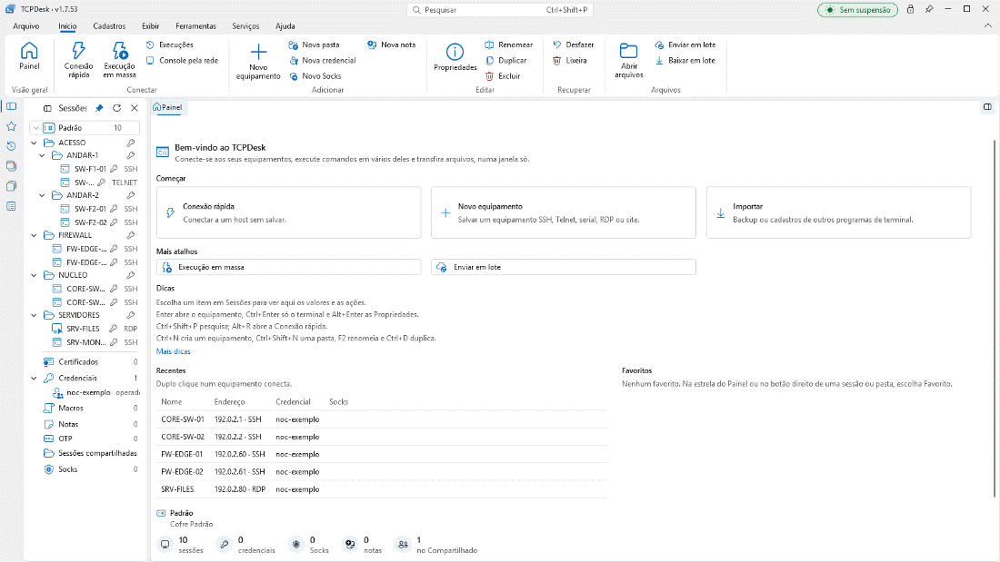
</p>

<table>
<tr>
<td width="33%" valign="top">

### 🗂️ Organizado
Cofres e pastas por rede, cliente ou local. A pasta passa para os equipamentos a credencial, o protocolo, a porta e o SOCKS. Busca em tudo com **Ctrl+Shift+P**.

</td>
<td width="33%" valign="top">

### ⚡ Rápido
Abra o mesmo conjunto de terminais com um clique (**Grupos salvos**), divida a tela e digite em várias abas ao mesmo tempo (**Terminal sincronizado**).

</td>
<td width="33%" valign="top">

### 🔒 Seguro
Senhas protegidas pelo Windows, nunca em texto aberto. Códigos OTP no próprio app. Atualização só por HTTPS e só com o SHA-256 conferido.

</td>
</tr>
</table>

## Funcionalidades

| | |
|---|---|
| 🖥️ **Terminais** | SSH, Telnet, serial e RDP em abas; tela dividida lado a lado ou em cima e embaixo; localizar na saída; log por sessão e histórico de logs. |
| 🚀 **Execução em massa** | Os mesmos comandos em dezenas de equipamentos ao mesmo tempo, com o resultado de cada um na própria linha; exportação e histórico das execuções. |
| 🧩 **Macros e ações ao entrar** | Usuário, senha, OTP e comandos iniciais enviados sozinhos ao conectar. |
| 📁 **Arquivos** | SFTP, SCP, FTP, FTPS, TFTP, WebDAV, WebDAVS e S3; enviar e baixar em lote para vários equipamentos. |
| 🔑 **Credenciais e OTP** | Credenciais compartilhadas por pasta, guardadas com a proteção do Windows; códigos de dois fatores gerados no app. |
| 🌐 **SOCKS e proxy** | Cliente SOCKS e proxy por pasta ou por equipamento, com herança. |
| 🛠️ **Servidores locais** | SOCKS, proxy HTTP/HTTPS, FTP, SFTP, SSH, TFTP, HTTP, SNMP e servidor de console. |
| ⭐ **Do seu jeito** | Favoritos, recentes, notas, Lixeira com Desfazer, tema claro e escuro, oito cores de destaque, escala da interface. |
| 🌎 **Português e inglês** | Todas as telas nos dois idiomas; o instalador também. |
| 🔄 **Sempre atualizado** | O app avisa da versão nova e se atualiza sozinho, mantendo os seus dados. |

## Fotos

<p align="center">
  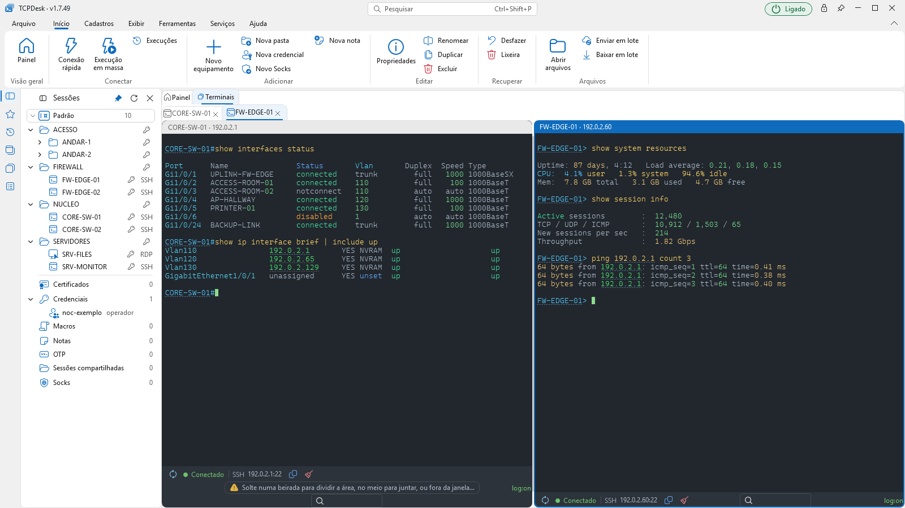<br>
  <sub>Dois equipamentos lado a lado, cada um com a sua barra de conexão.</sub>
</p>

| Tema escuro | Execução em massa |
|:---:|:---:|
| 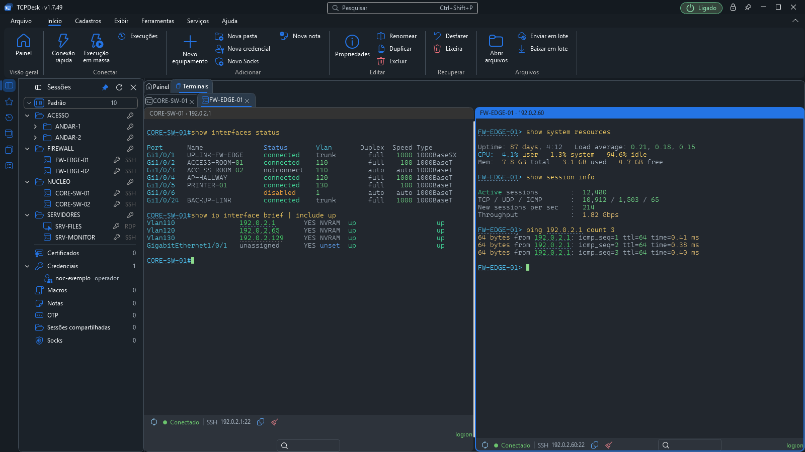 | 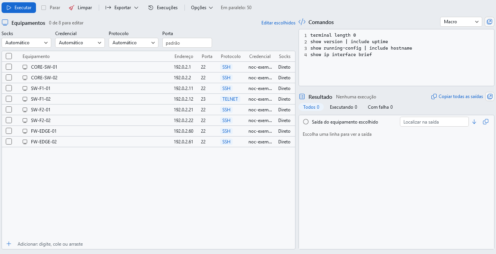 |
| **Propriedades da pasta** | **Grupos salvos** |
|  | 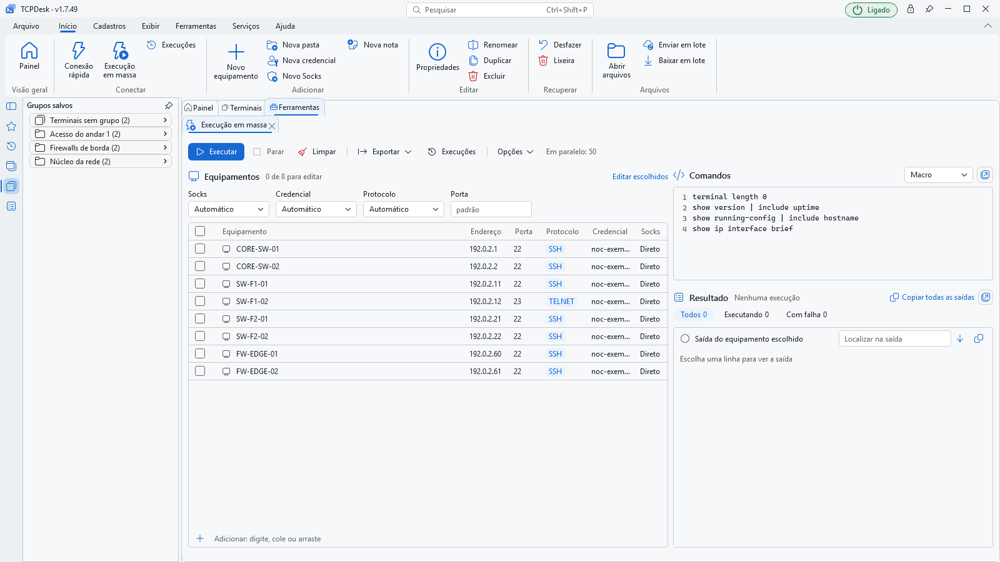 |
| **Configurações** | **Sessões e terminal** |
| 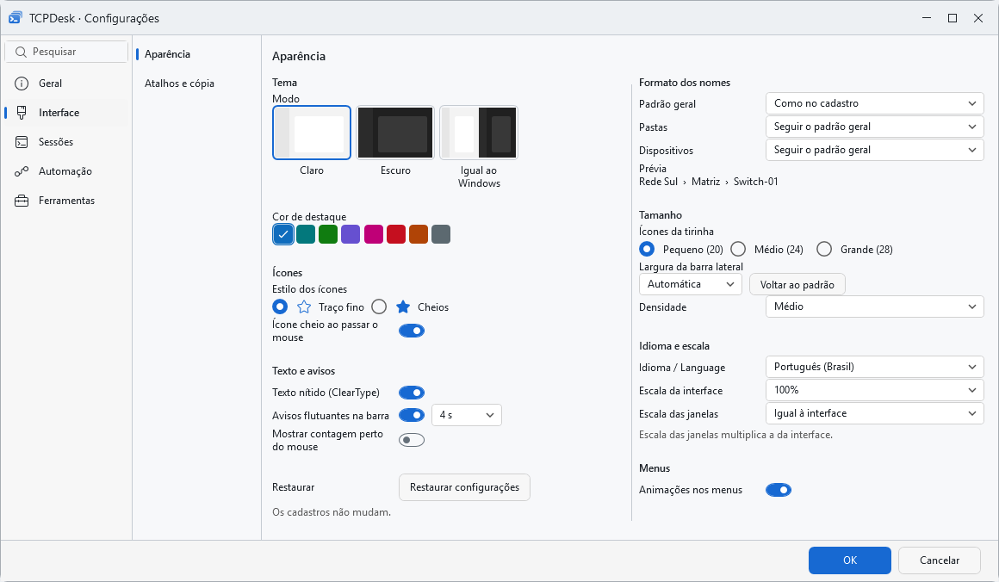 | 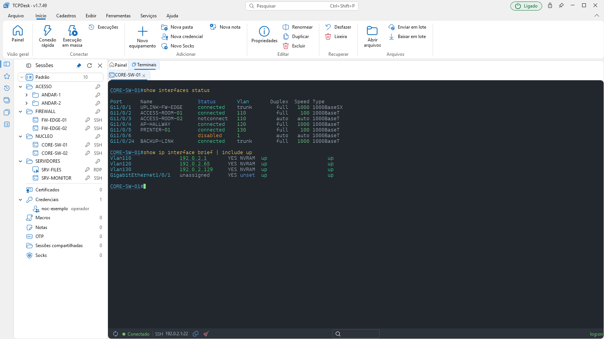 |

<sub>Todas as imagens usam dados fictícios.</sub>

## Instalar

1. Baixe na [página da versão mais nova](https://github.com/Dorflex-DD/TCPDesk-releases/releases/latest):
   - **Portátil (.zip)**: extraia e abra o `TCPDesk.exe`. Nada é gravado fora da pasta do app.
   - **Instalador (.msi)**: instala só para o seu usuário, sem administrador. Para atualizar, instale por cima; os dados continuam.
2. Os dois precisam do [Microsoft .NET 11 Desktop Runtime x64](https://dotnet.microsoft.com/download/dotnet/11.0).

O instalador abre em português. Para instalar em inglês:

```text
msiexec /i TCPDesk_vX_instalador_sem-runtime.msi TRANSFORMS=":1033"
```

Cada versão traz o `SHA256.txt` para conferir os arquivos. Veja [todas as versões](https://github.com/Dorflex-DD/TCPDesk-releases/releases).

Este projeto tem só as versões publicadas; o código-fonte não é público.

## Termos de uso

Leia o arquivo [LICENSE](LICENSE) (tradução para o inglês em [LICENSE-en](LICENSE-en)). © Fabio Giacomelli. Todos os direitos reservados.

---

<a id="english"></a>

<p align="center">
  
</p>

<p align="center">
  <a href="https://github.com/Dorflex-DD/TCPDesk-releases/releases/latest"><b>⬇️ Download the latest version</b></a> ·
  <a href="#features">Features</a> ·
  <a href="#screenshots">Screenshots</a> ·
  <a href="#install">Install</a>
</p>

**TCPDesk brings together everything network people use every day:** SSH, Telnet, serial and RDP terminals in tabs, commands on dozens of devices at once, file transfer, protected credentials, SOCKS tunnels and network servers, organized in vaults and folders.

<p align="center">
  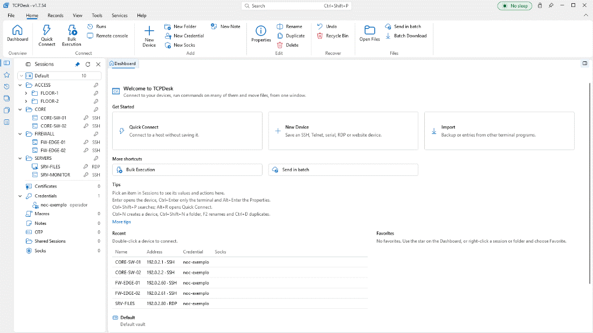
</p>

<table>
<tr>
<td width="33%" valign="top">

### 🗂️ Organized
Vaults and folders per network, customer or site. A folder passes its credential, protocol, port and SOCKS to its devices. Search everything with **Ctrl+Shift+P**.

</td>
<td width="33%" valign="top">

### ⚡ Fast
Open the same set of terminals in one click (**Saved groups**), split the screen and type into several tabs at once (**Synced terminal**).

</td>
<td width="33%" valign="top">

### 🔒 Secure
Passwords protected by Windows, never in plain text. OTP codes inside the app. Updates over HTTPS only, with the SHA-256 checked.

</td>
</tr>
</table>

<a id="features"></a>

## Features

| | |
|---|---|
| 🖥️ **Terminals** | SSH, Telnet, serial and RDP in tabs; split screen side by side or top and bottom; find in the output; per-session log and log history. |
| 🚀 **Bulk Execution** | The same commands on dozens of devices at once, with each device's result on its own row; export and run history. |
| 🧩 **Macros and login actions** | User, password, OTP and startup commands sent automatically when connecting. |
| 📁 **Files** | SFTP, SCP, FTP, FTPS, TFTP, WebDAV, WebDAVS and S3; batch send and download to many devices. |
| 🔑 **Credentials and OTP** | Credentials shared per folder, stored with Windows protection; two-factor codes generated in the app. |
| 🌐 **SOCKS and proxy** | SOCKS and proxy client per folder or per device, with inheritance. |
| 🛠️ **Local servers** | SOCKS, HTTP/HTTPS proxy, FTP, SFTP, SSH, TFTP, HTTP, SNMP and console server. |
| ⭐ **Your way** | Favorites, recents, notes, Recycle Bin with Undo, light and dark themes, eight accent colors, interface scale. |
| 🌎 **English and Portuguese** | Every screen in both languages, including the installer. |
| 🔄 **Always up to date** | The app tells you about new versions and updates itself, keeping your data. |

<a id="screenshots"></a>

## Screenshots

<p align="center">
  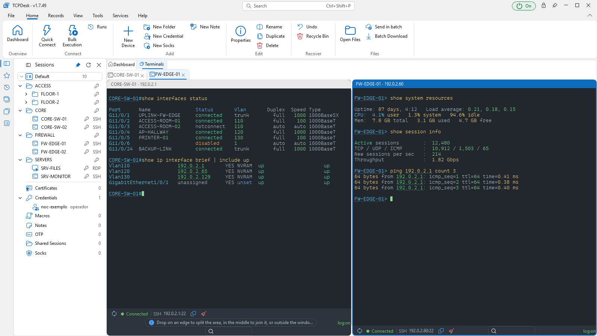<br>
  <sub>Two devices side by side, each with its own connection bar.</sub>
</p>

| Dark theme | Bulk Execution |
|:---:|:---:|
| 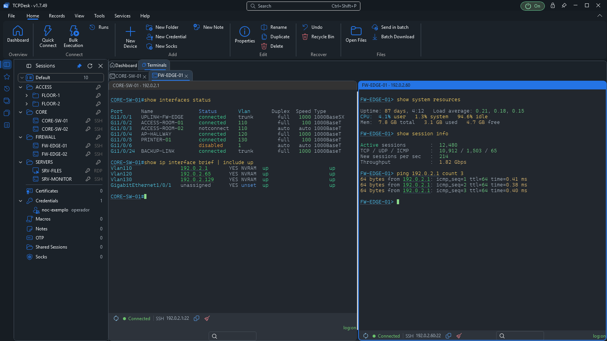 | 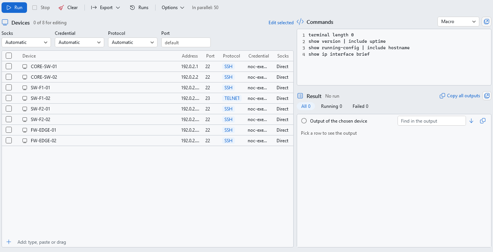 |
| **Folder properties** | **Saved groups** |
|  | 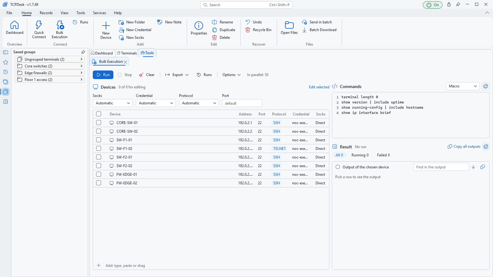 |
| **Settings** | **Sessions and terminal** |
|  |  |

<sub>All images use fictitious data.</sub>

<a id="install"></a>

## Install

1. Download from the [latest release page](https://github.com/Dorflex-DD/TCPDesk-releases/releases/latest):
   - **Portable (.zip)**: extract and open `TCPDesk.exe`. Nothing is written outside the app folder.
   - **Installer (.msi)**: installs for your user only, no administrator needed. To update, install over it; your data is kept.
2. Both require the [Microsoft .NET 11 Desktop Runtime x64](https://dotnet.microsoft.com/download/dotnet/11.0).

The installer opens in Portuguese. To install in English:

```text
msiexec /i TCPDesk_vX_instalador_sem-runtime.msi TRANSFORMS=":1033"
```

Each release includes `SHA256.txt` to check the files. See [all releases](https://github.com/Dorflex-DD/TCPDesk-releases/releases).

This project holds only the published versions; the source code is not public.

## Terms of use

See [LICENSE](LICENSE) (English translation in [LICENSE-en](LICENSE-en)). © Fabio Giacomelli. All rights reserved.
