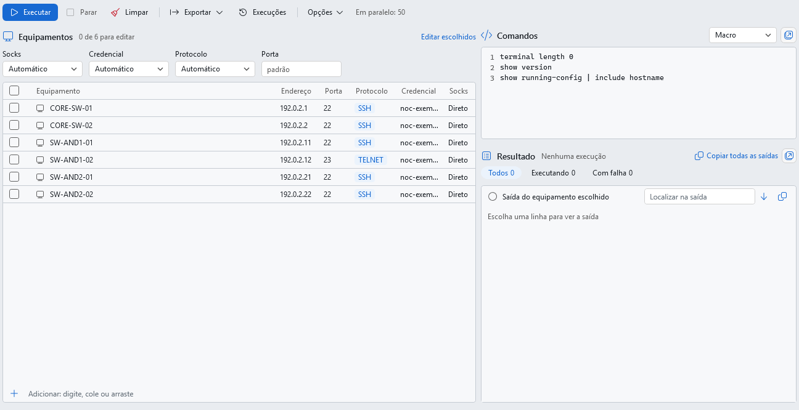
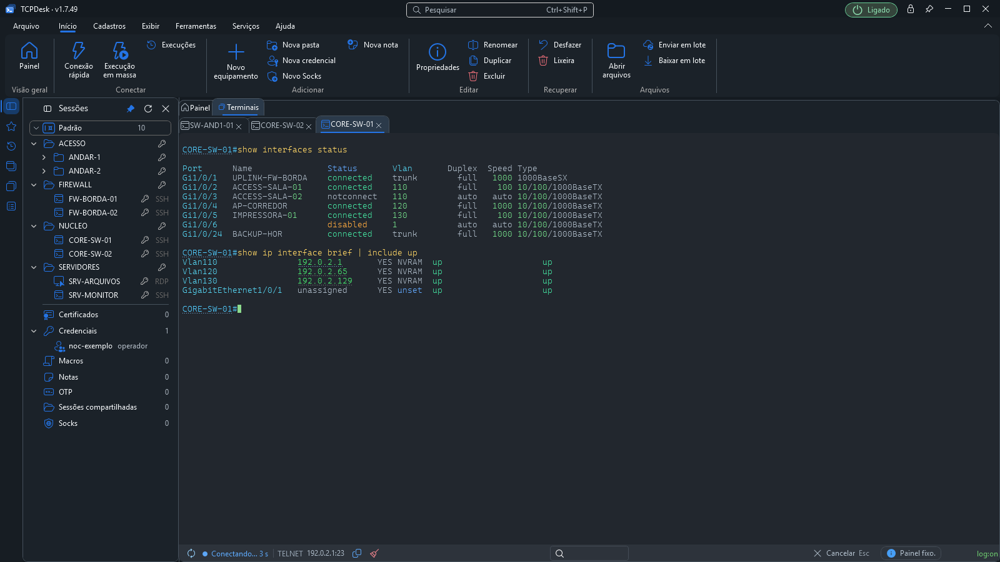
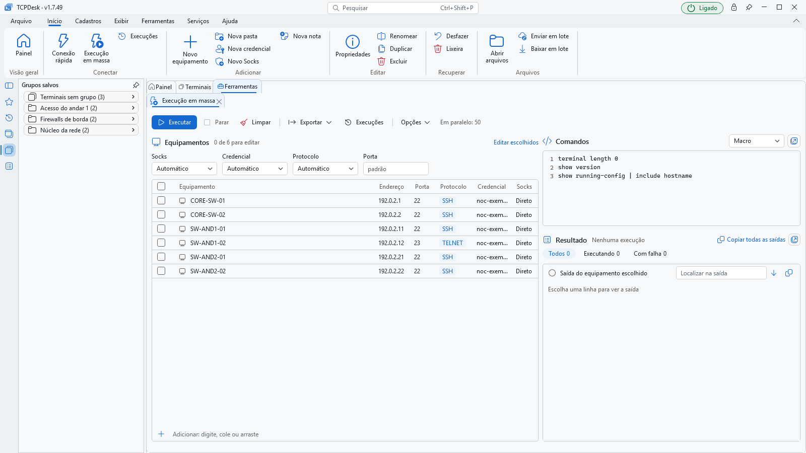
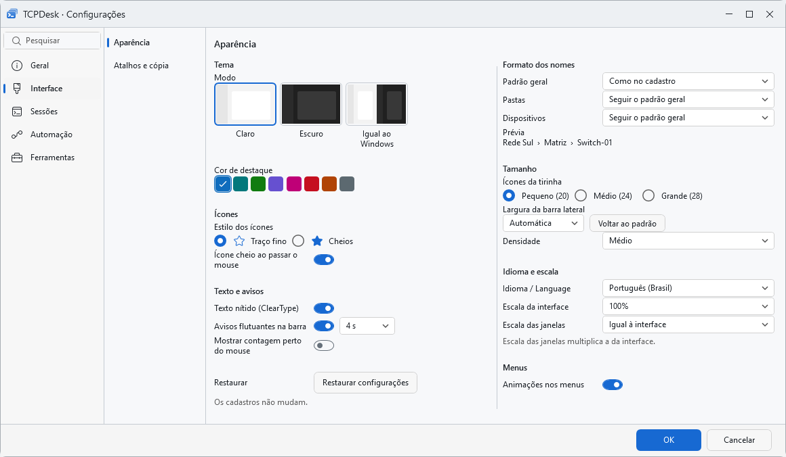
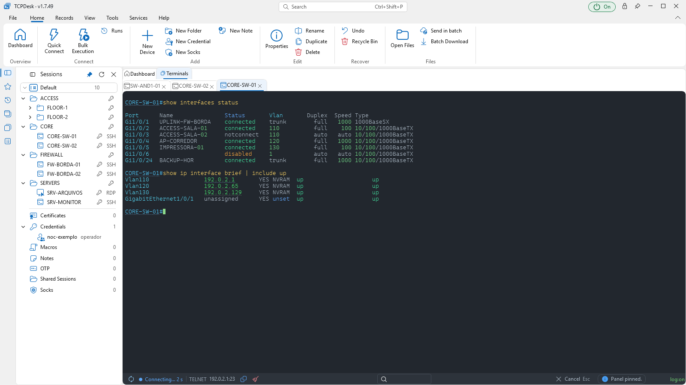
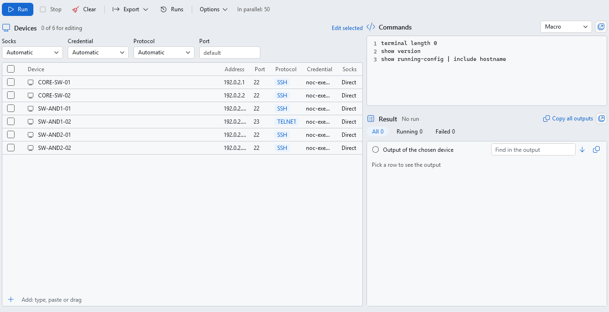
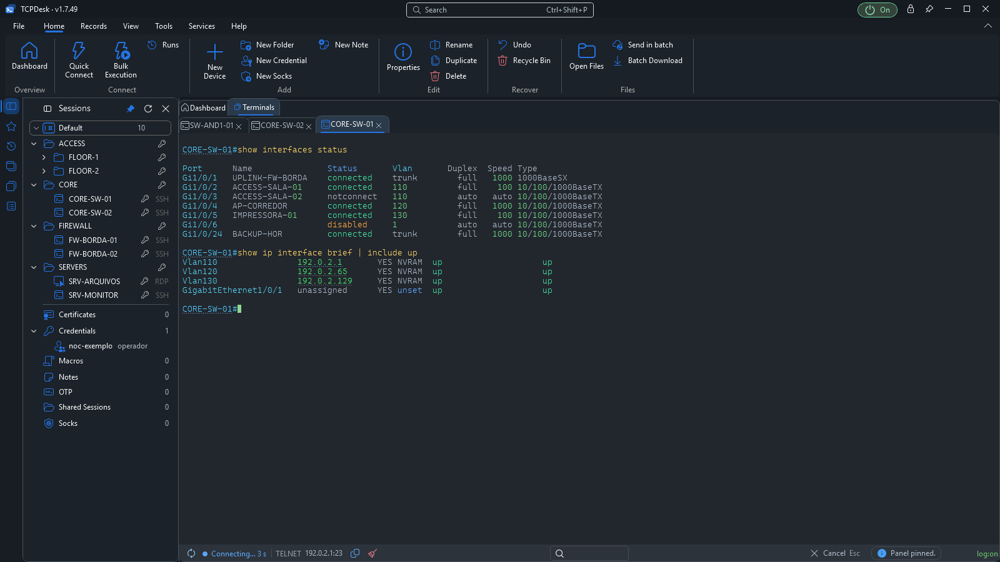
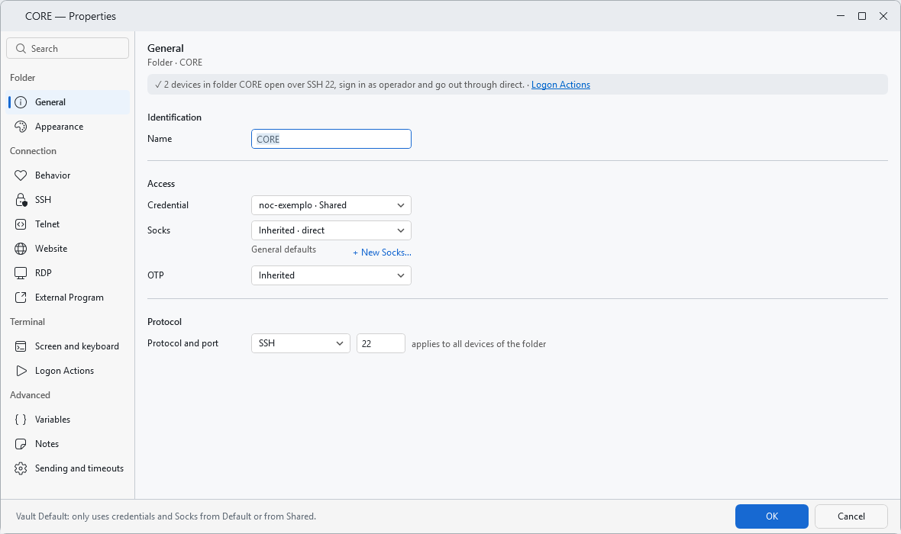
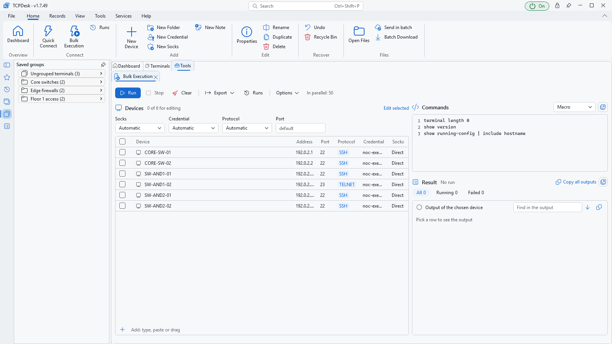

# TCPDesk

**Português** · [English](#english)

**Acesso e administração de equipamentos de rede no Windows, num lugar só.**
Terminais SSH, Telnet, serial e RDP em abas, comandos em massa, transferência de arquivos, credenciais, SOCKS e ferramentas de rede, organizados em cofres e pastas.

[**Baixar a versão mais nova**](https://github.com/Dorflex-DD/TCPDesk-releases/releases/latest) · [Todas as versões](https://github.com/Dorflex-DD/TCPDesk-releases/releases) · Windows x64


## Funcionalidades

### Sessões organizadas
- **Cofres e pastas** para separar redes, clientes ou locais. Cada pasta passa para os equipamentos dela a credencial, o protocolo, a porta, o SOCKS e as ações ao entrar.
- **Busca rápida** (Ctrl+Shift+P) em todos os equipamentos, pastas e comandos.
- **Grupos salvos**: abra de uma vez o mesmo conjunto de terminais que você usa todo dia.
- Favoritos, recentes, notas e Lixeira com Desfazer.

### Terminais
- **SSH, Telnet, serial e RDP** em abas, com a tela dividida lado a lado ou em cima e embaixo.
- **Terminal sincronizado**: o que é digitado numa aba vai para todas as abas escolhidas.
- Localizar na saída, copiar a saída toda, log por sessão e histórico de logs.
- **Macros** e ações ao entrar (usuário, senha, OTP e comandos iniciais).

### Comandos em massa
- **Execução em massa**: os mesmos comandos em dezenas de equipamentos ao mesmo tempo, com o resultado de cada um na própria linha.
- Exportação dos resultados e histórico das execuções.



### Arquivos
- **Transferência de arquivos** por SFTP, SCP, FTP, FTPS, TFTP, WebDAV, WebDAVS e S3.
- **Enviar e baixar em lote** para vários equipamentos de uma vez.

### Rede e segurança
- **Credenciais protegidas** pelo Windows; senhas nunca ficam em texto aberto.
- **Códigos OTP** (dois fatores) gerados no próprio app.
- **Cliente SOCKS e proxy** por pasta ou por equipamento, com herança.
- **Servidores locais**: SOCKS, proxy HTTP/HTTPS, FTP, SFTP, SSH, TFTP, HTTP, SNMP e servidor de console.

### Do seu jeito
- Tema **claro e escuro**, oito cores de destaque, tamanho de ícones e escala da interface.
- Telas em **português e inglês**.
- **Portátil** (nada é gravado fora da pasta do app) ou **instalador** só para o seu usuário, sem administrador.
- **Atualiza sozinho**, só por HTTPS e só se o SHA-256 do pacote conferir.

| Tema escuro | Propriedades da pasta |
|---|---|
|  |  |

| Grupos salvos | Configurações |
|---|---|
|  |  |

## Instalar

Os pacotes estão na [página da versão mais nova](https://github.com/Dorflex-DD/TCPDesk-releases/releases/latest). Os dois precisam do [Microsoft .NET 11 Desktop Runtime x64](https://dotnet.microsoft.com/download/dotnet/11.0).

1. **Portátil (.zip)**: extraia e abra o `TCPDesk.exe`, sem instalar.
2. **Instalador (.msi)**: instala só para o seu usuário. Para atualizar, instale por cima; os seus dados continuam.

O mesmo MSI abre em português. Para instalar em inglês:

```text
msiexec /i TCPDesk_vX_instalador_sem-runtime.msi TRANSFORMS=":1033"
```

Cada versão traz o `SHA256.txt` para conferir os arquivos. Depois de instalado, o TCPDesk avisa das versões novas e se atualiza pelo próprio app.

Este projeto tem só as versões publicadas. O código-fonte não é público. As imagens usam dados fictícios.

## Termos de uso

Leia o arquivo [LICENSE](LICENSE) (a tradução para o inglês está em [LICENSE-en](LICENSE-en)). © Fabio Giacomelli. Todos os direitos reservados.

---

<a id="english"></a>

# TCPDesk (English)

**Network device access and administration on Windows, all in one place.**
SSH, Telnet, serial and RDP terminals in tabs, bulk commands, file transfer, credentials, SOCKS and network tools, organized in vaults and folders.

[**Download the latest version**](https://github.com/Dorflex-DD/TCPDesk-releases/releases/latest) · [All releases](https://github.com/Dorflex-DD/TCPDesk-releases/releases) · Windows x64



## Features

### Organized sessions
- **Vaults and folders** to keep networks, customers or sites apart. Each folder passes its credential, protocol, port, SOCKS and login actions down to its devices.
- **Quick search** (Ctrl+Shift+P) across all devices, folders and commands.
- **Saved groups**: open the same set of terminals you use every day in one go.
- Favorites, recents, notes and a Recycle Bin with Undo.

### Terminals
- **SSH, Telnet, serial and RDP** in tabs, with a split screen side by side or top and bottom.
- **Synced terminal**: what you type in one tab goes to all the tabs you choose.
- Find in the output, copy the whole output, per-session log and log history.
- **Macros** and login actions (user, password, OTP and startup commands).

### Bulk commands
- **Bulk Execution**: run the same commands on dozens of devices at once, with each device's result on its own row.
- Export the results and keep a history of runs.



### Files
- **File transfer** over SFTP, SCP, FTP, FTPS, TFTP, WebDAV, WebDAVS and S3.
- **Batch send and download** to many devices at once.

### Network and security
- **Credentials protected** by Windows; passwords are never stored in plain text.
- **OTP codes** (two-factor) generated inside the app.
- **SOCKS and proxy client** per folder or per device, with inheritance.
- **Local servers**: SOCKS, HTTP/HTTPS proxy, FTP, SFTP, SSH, TFTP, HTTP, SNMP and console server.

### Your way
- **Light and dark** themes, eight accent colors, icon size and interface scale.
- Screens in **English and Portuguese**.
- **Portable** (nothing is written outside the app folder) or an **installer** for your user only, no administrator needed.
- **Updates itself**, over HTTPS only and only when the package SHA-256 matches.

| Dark theme | Folder properties |
|---|---|
|  |  |

| Saved groups | Settings |
|---|---|
|  |  |

## Install

The packages are on the [latest release page](https://github.com/Dorflex-DD/TCPDesk-releases/releases/latest). Both require the [Microsoft .NET 11 Desktop Runtime x64](https://dotnet.microsoft.com/download/dotnet/11.0).

1. **Portable (.zip)**: extract and open `TCPDesk.exe`, without installing.
2. **Installer (.msi)**: installs for your user only. To update, install over it; your data is kept.

The same MSI opens in Portuguese. To install in English:

```text
msiexec /i TCPDesk_vX_instalador_sem-runtime.msi TRANSFORMS=":1033"
```

Each release includes `SHA256.txt` to check the files. Once installed, TCPDesk tells you about new versions and updates itself from inside the app.

This project holds only the published versions. The source code is not public. The images use fictitious data.

## Terms of use

See [LICENSE](LICENSE) (English translation in [LICENSE-en](LICENSE-en)). © Fabio Giacomelli. All rights reserved.
