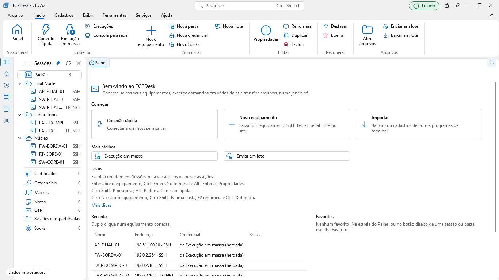
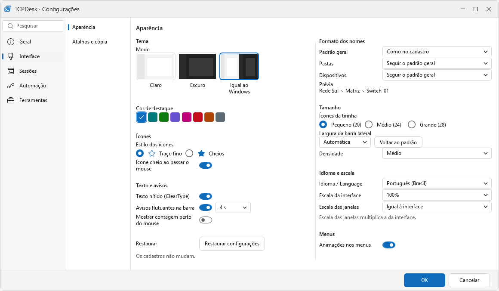
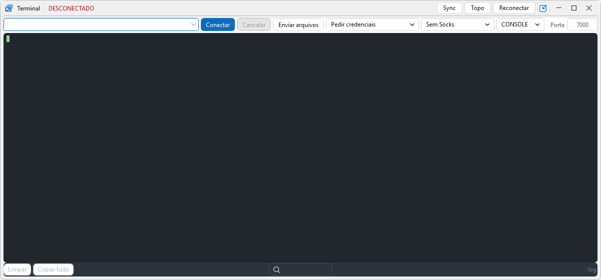
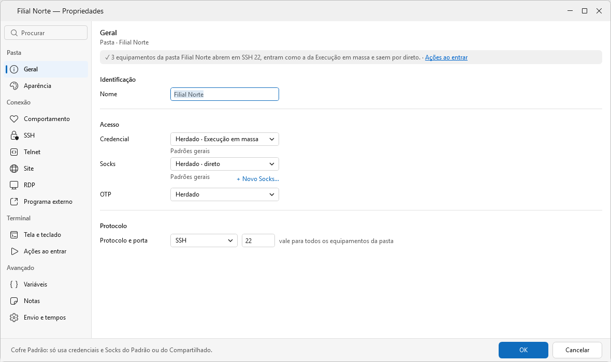

# TCPDesk

Terminais SSH, Telnet, serial e RDP em abas, comandos em vários equipamentos e transferência de arquivos, numa janela só. / SSH, Telnet, serial and RDP terminals in tabs, commands on many devices and file transfer, in one window.

## Baixar / Download — v1.7.52

- [Instalador / Installer (.msi)](https://github.com/Dorflex-DD/TCPDesk-releases/releases/latest/download/TCPDesk_v1.7.52_instalador_sem-runtime.msi)
- [Portátil / Portable (.zip)](https://github.com/Dorflex-DD/TCPDesk-releases/releases/latest/download/TCPDesk_v1.7.52_executavel_sem-runtime.zip)
- [Todas as versões / All releases](https://github.com/Dorflex-DD/TCPDesk-releases/releases/latest)

Windows 10/11 x64 · .NET 11 Desktop Runtime

## Novidades / What's new

- As Configurações abrem mais rápido. / Settings opens faster.
- Janela Terminal mais enxuta e alinhada. / Leaner, aligned Terminal window.

Uso somente com autorização escrita do autor (LICENSE). / Use only with the author's written authorization (LICENSE-en).
